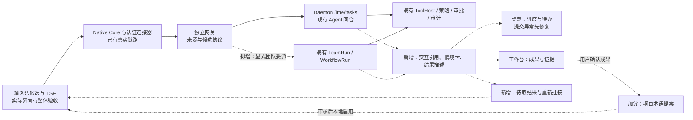

# OwO 大创实施方案：任务接力与成果回流

> **方向修订（2026-10-22）**：用户已确认将研究主线调整为“持续个性化学习 → 下一步意图预测 → Agent 执行与验收”。后续开发请读[个性化学习与主动协同实施方案](D:/OwO/OwO-agent-dev/docs/大创/OwO大创实施方案-个性化学习与主动协同-2026-10-22.md)。本文保留为上一版方案；其中仅保留任务接力、把项目用语作为可选项等优先级和实验安排已被新版替代，历史完成度证据仍按注明范围理解。

> 更新：2026-10-22（Asia/Shanghai）。用途：后续开发、创新训练申报、阶段验收与答辩准备。
> 事实基线：`master@594f9732`、`agent-frame@98324302`，以及 `feat/ime-agent-access` 中尚未提交的实现。2026-10-22 已更新远端引用，两条远端主分支仍对应上述提交。
> 本文是后续实施建议；“拟实现”“目标”“门槛”均不表示已经完成。学校申报类别、结题日期、团队人数及经费尚未确认，排期采用可调整的工作量假设。

## 1. 方向与取舍

建议项目名称：**OwO——面向学习与项目协作的情境原生智能输入系统**。

研究副标题：**中文输入场景中的任务接力与可校验成果回流机制**。

产品主线：**输入时发起任务 → Agent 持续执行 → 桌宠呈现进度和待办 → 用户回到编辑位置取用结果 → 经确认的项目成果改善后续输入。**

当前最有价值的基础已经具备：输入法核心能够调用完整 Agent，真实团队能够完成文件制作和独立评审。接下来把这些能力组织成一个连续、可观察、可恢复的使用过程。

本轮收敛为两个必做创新机制和一个加分机制：

1. **任务接力**：输入法、桌宠、工作台共同观察同一个任务；切换入口、切换窗口、连接重建后能够找回它。
2. **可校验成果回流**：同一次任务提供“可插入摘要、可打开文件、可追溯证据”，输入目标变化时把结果保留为待取内容。
3. **项目用语回流**：从用户确认的项目交付物提炼术语提案，用户审核后，在该项目的输入候选中生效。这项作为进阶加分，核心链路未完成时可延期。

Agent 现有权限、工具、审批、工作流、WorkSwarm 和审计作为共同底座。复杂任务可以显式交给团队；简单任务默认使用单 Agent。暂不把全桌面自主操作、跨机蜂群、自动读取所有应用、训练新基础模型列为本轮必交付内容。研究场景的收敛不改变 Agent 既有工具能力；输入法的实际调用范围继续由用户在 Desktop 设置中选择。

建议优先按**创新训练项目**组织材料：提出研究问题、完成原型、执行对照实验、形成可复核报告。教育部管理办法将创新训练的过程覆盖到项目设计、实施、研究报告与成果交流；这支持把工程原型与研究验证一起交付。[教育部管理办法](https://www.moe.gov.cn/srcsite/A08/s5672/201907/t20190724_392132.html) 不同学校当年的评分、期限和经费要求另行对齐。

## 2. 当前完成度：按证据分层

### 2.1 状态口径

| 标记 | 含义 | 对外可以怎样说 |
| --- | --- | --- |
| 实测通过 | 已在注明的入口、版本和场景中真实运行 | 指明具体场景与结果 |
| 已实现，待整体验收 | 源码与接线存在，部分测试通过，完整使用过程未通过 | 说明已有基础和剩余门槛 |
| 既有模块可复用 | 有模块、协议或历史测试，未在本轮新场景验证 | 作为技术基础介绍 |
| 待实现 | 本轮需要设计与开发 | 写入研究内容和里程碑 |

一个小任务成功只能证明该任务。单测通过、模块存在、API 成功、实际候选栏交互和安装包可用分别记录，不相互替代。

### 2.2 已经完成的部分

| 能力 | 当前判断 | 已有证据与范围 |
| --- | --- | --- |
| 两条主分支与独立构建边界 | 已整理开发基线 | `master` 与 `agent-frame` 为两个主要分支；IME、网关、SDK 独立构建。后续不按旧方案改名为唯一主线 |
| 中文输入、统一候选、输入法核心及连接器 | 既有基础，部分原生验证通过 | `master@594f9732` 包含此前合入的统一输入与修饰键路由修复；不能据此宣称所有宿主应用兼容 |
| 普通输入法任务调用完整 Agent | **核心链路实测通过** | Native Core → 已安装连接器 1.3.2 → 当前网关 → Daemon → 真实模型 → `read_file`、`list_dir` → 结果 42 → 同一 Desktop 会话 |
| 输入法调用范围设置 | 已实现，相关测试通过 | Desktop 可选关闭、只读、跟随 Agent、自定义权限，设置目录和工具范围；变更会撤销活动任务范围 |
| 任务来源认证、幂等、会话来源保存 | 已实现，相关集成测试通过 | 独立任务来源签名域、去重身份、SQLite 来源持久化、恢复时沿用限制。它们是软件来源与策略检查，不是物理键盘来源证明 |
| 单 Agent 工具、审批和取消 | 既有底座，IME 场景有集成验证 | 复用已有 Agent/ToolHost；写入审批、限制、去重、撤权有服务端测试；本轮真实 IME 小任务为只读 |
| 团队拆分、执行、独立评审与文件交付 | **团队 API 小任务实测通过** | `team-82e8bdc2`：lead、w1、reviewer 均成功；636 字节 Markdown 文件真实落盘，评审员实际读文件，结构化 verdict 为 approved |
| 工作台展示团队记录和真实文件条目 | 实测通过这一展示范围 | 已查看完成状态、角色对话、工具记录及交付文件条目；尚未据此认定所有文件打开动作通过 |
| 桌宠文字投喂、确认窗、成员状态逻辑 | 已实现，完整提交过程未通过 | 右键接收文字和确认窗内容加载已观察到；确认窗 IPC 误拒绝已修复。确认后仍有显示/未建队问题待定位；快捷键与本机截图工具冲突 |
| 原位置保护与 TSF 回写 | 有现有实现，当前组合待整体验收 | TSF 记录上下文/范围/摘要，编辑或焦点变化使原目标失效，回写前再检查；尚未完成当前 Agent 组合下的实际键入和候选选择验收 |
| 工作流、记忆、学习、感知、词频学习 | 既有模块可复用 | 各模块与部分接口存在；“项目情境卡、跨入口接力、交付物自动形成词库”仍须新增产品接线与验证 |

最新桌面端相关全套测试为 94 项通过，网页端桌宠/交付相关 39 项通过。网关最近库测试 72 项通过、1 项默认忽略，C++ 互操作此前单独通过。完整网关测试曾因运行中 EXE 被 Windows 锁定退出 101，不能写成最近完整重跑成功。

### 2.3 仍须完成的部分

| 编号 | 缺口 | 类型 | 完成后用户得到什么 |
| --- | --- | --- | --- |
| F01 | 桌宠确认后无法稳定完成建队 | 修复、现场验收 | 右键投喂后能看到真实队伍和真实成果 |
| F02 | 实际 TSF 键入、候选确认、结果取用未验收 | 集成验收 | 在支持的普通输入框中完整使用 |
| F03 | 输入法任务与 TeamRun/WorkflowRun 缺少统一接力引用 | 新增接线 | 从任一入口看见同一任务，继续或取消不会发起第二次任务 |
| F04 | 焦点失效后的待取结果和重新挂接 | 新增功能 | 离开后任务继续，回来能找到结果并明确选择放到哪里 |
| F05 | 用户可见、可修正的项目情境卡 | 新增功能 | 看得见本次引用哪些文字、文件、项目和输出目录 |
| F06 | 团队执行链继承 IME 调用范围 | 扩展现有范围机制 | 从输入法升级团队后仍受原目录、工具及即时撤权约束 |
| F07 | 统一成果摘要、文件与证据入口 | 扩展现有展示 | 简短内容留在候选栏，长文档/文件在工作台打开 |
| F08 | 项目词汇提案到输入候选的可撤销回流 | 进阶创新 | 项目术语更容易输入，用户能审核、停用和删除 |
| F09 | 工作流在输入法中参数化复用 | 后续扩展 | 同类任务再次触发时少填信息、少做重复规划 |
| F10 | 成套安装、断连诊断、外部体验评测 | 交付与研究 | 换一台测试电脑能复现，能用数据说明价值 |

当前功能改动仍在开发分支，未提交/推送、未发布本轮安装包。旧文档里“完全脱钩”“来源机制零实现”的结论已不代表当前状态；其中对所有应用无缝回填、物理按键可信、通用桌面自治的设想也不能作为现有成果。

## 3. 三个连续场景，把输入法和 Agent 串起来

### 场景 A：写项目进展时就地获得材料

用户在编辑器写：“根据本周项目记录整理进展，给出三条已完成事项和两条下一步计划。”

输入法显示任务草稿。用户展开情境卡，确认使用当前选中文字与两个项目文件，输出为一段摘要。单 Agent 执行，候选栏显示“摘要已就绪”，用户预览并选择插入。若原位置发生编辑，则显示“结果已保存，选择当前位置后插入”，不继续沿用失效范围。

**新增价值**：入口、输入内容和输出位置在同一次交互中关联；研究重点是减少重复复制材料与重新描述任务。

### 场景 B：把长任务交给团队，继续做自己的事

用户在同一任务草稿选择“团队制作”，要求根据选定的课程资料和一份实验数据，生成实验小结与检查清单。

确认内容后进入现有 TeamRun。用户切换到另一个窗口，任务继续。桌宠只在需要补充材料、审批或完成时提醒；工作台展示角色和验证证据。完成后产生一个可插入摘要和两个可打开文件。用户回到任意允许的输入框，手动取用摘要；无有效原位置证明时重新绑定目标。

**新增价值**：用户在几个表面上管理的是一个任务；任务状态和结果不会因为入口窗口消失而丢失。

### 场景 C：项目产出改善后续中文输入

用户确认交付后，系统从该项目已批准的文件中提出“上下文切片”“交付回执”等术语及简称映射，附上来源段落。用户只采纳需要的词条。

下一次在这个项目输入对应拼音或简称，项目词条参与本地候选排序；切换项目后停用该项目词表。删除词条后恢复原行为。

**新增价值**：Agent 的成果变成以后输入时可复用的资产；可用候选命中率、纠错次数和误推荐率验证效果。

首版材料限定为项目内 UTF-8 文本、Markdown 和小型 CSV。PDF、Word 的解析质量、复杂表格和引用定位分别列为扩展，已有解析模块也必须先验证才加入演示。上述三段可以使用同一个课程/项目案例串成答辩演示。

## 4. 创新点如何形成可研究的机制

### 4.1 必做：跨入口任务接力

**研究问题 RQ1**：在模型和工具相同的情况下，输入焦点发起、共享任务状态和结果待取机制，能否降低任务中断后的恢复成本？

方法分为三部分：

- 发起时生成交互引用，绑定源请求、情境版本、原有会话/回合或团队标识；输入法、桌宠和工作台只保留引用，不各建一个执行任务。
- 离开输入位置与明确取消分开处理。离开只停止该位置的更新，明确取消才传播到当前执行对象。
- 断线后先按已有引用查状态；提交结果不确定时查询原请求，避免直接重发执行。

**可验证产出**：接力状态机、兼容契约、故障注入样例、恢复时间与重复执行率报告。

**新颖性表述边界**：贡献定位为中文输入场景的协同交互机制与系统实现。来源签名与一般任务状态机已有研究及工程先例，不单独宣称世界首创。

### 4.2 必做：可校验成果回流

**研究问题 RQ2**：把输出关联到原任务、源材料版本和有效输入位置，能否减少结果遗失、重复找回和错误位置插入？

每次交付生成一份小型结果描述：摘要、文件引用、验证状态、来源任务、用户可选动作。摘要供候选栏取用，文件供工作台查看，验证状态供用户判断是否使用。

“原处”分两种能力，分别验收：

1. **原目标仍有效**：继续复用已有 TSF 上下文、范围与内容摘要校验，用户确认后取用结果。
2. **原目标已失效**：保留任务和结果，用户重新选择位置并确认后创建新目标绑定。当前源码对编辑/焦点变化采取永久失效处理，不能通过匹配同一窗口标题、相同文字或旧坐标悄悄恢复绑定。

第二种先完成“重新挂接后取用”。自动识别返回的是原文档、原范围属于后续研究，需要稳定文档身份与宿主支持，不作为首版承诺。重启后不能恢复已失效的 COM 指针或输入上下文能力。

**可验证产出**：结果描述契约、待取结果队列、回写确认过程、错位测试集、成功取用率与恢复成本实验。

### 4.3 加分：用户可控的项目用语回流

**研究问题 RQ3**：仅从用户已确认的项目成果提取术语，并经用户选择后参与输入排序，能否改善项目专有词输入，同时控制无关词污染？

首版使用可解释、可调的提案排序：项目文档重复出现次数、标题/术语表位置、用户采纳次数、近期使用及来源可信状态。全拼、简称映射由用户校正；优先使用现有拼音能力。模型可以提出词条，不直接写入系统词库。

提案需带项目 ID、词条、拼音/简称、来源文件及段落、文件版本、采纳状态。项目候选先作为词库上方的一层可卸载增量，避免直接污染全局词频。是否复用已有词库资源安装接口，在实现时核对其隔离与更新粒度后确定。

先做“提案→审核→项目内启用→撤销”，再考虑自动排序学习。用户拒绝的内容不会反复弹出；不把普通键入记录默认收集成训练数据。

### 4.4 三者的关系

任务接力解决“任务还在不在”；成果回流解决“结果能否正确取用”；项目用语回流解决“这次成果能否帮助下一次输入”。输入法提供发起位置和本地候选，Agent 提供执行与验证，桌宠提供持续但低打扰的任务可见性。

情境卡先由用户选择项目、材料和使用场景；应用类型只作建议。共享的是有来源、可修正的结构化内容，不在首版新增全屏监视或自动抓取所有窗口正文。

### 4.5 与已有研究和产品机制的区别

任务上下文、任务恢复和个性化排序都有研究基础，应把创新写成明确的增量问题。

| 参照 | 已有思路 | 本项目拟研究的增量 |
| --- | --- | --- |
| Eclipse Mylyn | 任务上下文可以管理相关编辑器、过滤信息并调整内容辅助排序 | 从 IDE 内部任务上下文扩展到中文输入入口、现有 Agent 任务引用和经用户确认的项目词汇回流；增量有效性需实测 |
| 任务中断与恢复研究 | 已有现场研究讨论中断后的任务恢复行为 | 把任务仍在执行、结果已完成、原输入位置已失效分开呈现，测量重新取用结果的成本 |
| CaMeL / AgentDojo | 数据与控制隔离、能力检查及正常/对抗任务评估有现成研究体系 | 复用现有 Agent 的控制边界，补齐输入来源、结果目标、跨入口关联及中文输入场景的回归与用户研究 |

Mylyn 的能力参照[官方任务聚焦界面说明](https://help.eclipse.org/latest/topic/org.eclipse.mylyn.help.ui/Mylyn/FAQ/Task-Focused-UI.html)；任务恢复问题参照 [Iqbal 与 Horvitz 的现场研究](https://www.microsoft.com/en-us/research/publication/conversations-amidst-computing-study-interruptions-recovery-task-activity/)。这些工作说明问题有研究基础，也要求本项目用对照与消融说明新增机制的贡献，而不能仅因实现了任务上下文就宣称原创。

## 5. 目标架构与接线位置

下图是目标结构，虚线部分为新增或仍待完成的接线；它不是当前全部实测通过的声明。

### 5.1 三端职责

| 部分 | 复用 | 需要新增 | 避免重复建设 |
| --- | --- | --- | --- |
| 输入法 | 本地候选、TSF 来源捕获、效果处理、连接器 | 任务卡/结果待取候选、重新挂接、项目词条增量 | 不嵌入另一套 Agent，不在按键线程等待云端 |
| 网关 | 认证管道、签发来源、现有 Agent 桥、候选进度 | 版本协商、统一执行引用、团队/工作流适配、断线恢复映射 | 不独立创建第二套权限、模型连接或队伍引擎 |
| Agent Daemon | 会话、回合、TeamRun、ToolHost、审批、审计、Artifact | 跨入口来源关联、情境卡、结果描述及范围传播适配 | 不另建任务调度器和工具注册表 |
| Desktop/桌宠 | 设置、团队详情、真实文件展示、桌宠动画与通知 | 修复确认后流程、按任务精确呈现、结果与重新挂接提示 | 桌宠角色切换与窗口数量不作为新 Agent 数量的证据 |

### 5.2 拟新增的数据对象

以下为设计草案，尚未加入当前协议；优先扩展已有 DTO 和持久化设施。

| 对象 | 最小内容 | 处理方式 |
| --- | --- | --- |
| `InteractionRef` | 交互 ID、源请求去重键、执行种类、现有 session/turn 或 team/run 引用 | 小型持久关联记录；执行状态仍从原引擎读取 |
| `ContextCard` | 用户任务原文、项目、选中文字、材料引用/版本、输出形式、用户确认版本 | 提交前可预览和修改；原始材料与任务指令分字段 |
| `ReturnTarget` | 输入法实例、上下文代次、范围标识、文本摘要、有效状态 | 目标能力只在有效本地生命周期内保留；持久记录不等于可写授权 |
| `DeliveryEnvelope` | 任务引用、摘要、文件引用、验证结果、来源版本、待取状态 | 存文件引用与摘要，避免把大文件塞入候选响应 |
| `ProjectTermProposal` | 项目、词条、拼音/简称、来源及版本、审核状态 | 本地可撤销增量，与全局词频隔离 |

`ContextCard` 中的内容版本与原始任务摘要都要参与确认，不能显示一份内容却执行另一份内容。来源凭证只证明受信连接器/网关提交了某个请求；不证明文字完全来自物理按键，不证明用户已授权执行其中所有动作。

### 5.3 接口演进与兼容

当前 `ImeTaskRequest` 只有 `prompt` 与 `origin_capsule`，回执是 `session_id/turn_id`。**当前没有输入法团队委派的正式契约。**

建议保留现有接口，新增经过版本协商的接力契约，例如拟议的 `POST /ime/tasks/v2`：用户明确选择 `agent`、`team` 或已登记工作流，返回带执行种类的引用。最终路径和 DTO 在任务 F03 开始时定案，同步路由测试、OpenAPI、TS 类型及 IPC 黄金样例。

不能仅给旧 v3/v4 请求塞新字段并假定旧端会忽略；现有部分类型采用拒绝未知字段的解码方式。旧端未声明能力时继续使用现有 Agent 任务与工作台查看结果。候选控制继续使用结构化命令 ID，显示文字不作为控制协议。

团队升级前须把 IME 来源、目录、工具集合与即时撤权传播到 TeamRun 和每个 Worker，并验证恢复路径。对未覆盖的直接团队入口维持既有 Desktop 策略，不默认继承一份宽松的输入法设置。

现有自然语言/工作流入口包含多种兼容路径；实现前逐个核对是否走真实执行器。带 MockBackend 的入口不得作为实机工作流验收。首版直接复用已验证的普通回合与 `/teams` 执行路径。

### 5.4 三条关键状态链

- 执行：草稿 → 用户确认 → 已接收 → 执行中/待处理 → 完成、失败或取消。窗口断开只改变观察状态。
- 取用：结果就绪 → 原目标可用，或需要重新挂接 → 用户确认取用 → 已插入并有回执，或明确失败/状态待核实。状态待核实时不自动重试写入。
- 复用：交付已确认 → 术语/流程提案 → 用户采纳 → 指定项目可用 → 修改、停用或删除。复用流程要重新检查参数和当前权限，不携带上次审批票据。

实现时沿用原引擎状态定义，在呈现层映射上述中文状态，不另外维护一套彼此冲突的执行终态。

## 6. 实施顺序与验收门槛

### P0：完成现有能力的真实使用闭环

先处理 F01、F02 及发布前的来源版本记录。

1. 定位桌宠确认动作之后的 IPC 回应、弹窗销毁、主宠物页面存活、POST 发送、响应和绑定保存，逐点记录固定诊断码；目前只确认 IPC 加载问题已修复，不能把后续异常预先归因。
2. 桌宠实际投喂同一个小任务，必须由该界面真实创建 TeamRun。验收时不使用脚本调用 `/teams` 代替该次提交。
3. 在最小受支持的普通 TSF 测试编辑器中，实际键入、候选确认、执行、预览、取用；增加浏览器普通多行输入框作为第二个样本。
4. 单独验证“打开文件”按钮、断连重试提示、快捷键冲突检测与可配置替代入口。

**P0 门槛**：两条入口各重复 5 次，任务与文件内容正确、没有重复创建；桌宠确认窗和主页面正常存活；实际候选选择可完成一次读文件任务和一次受控文件交付。失败记录保留，不以重跑后成功隐藏前一次失败。

本轮仅建立明确支持的少量宿主场景。此前暂停的大范围跨应用兼容专项继续延期；新扩展应用另开验收行，不承诺 Word、所有聊天软件、所有浏览器编辑器通用。

### P1：完成“同一任务接力”和成果待取

实现 F03—F07 的最小集合。先支持普通 Agent 回合接力，再接团队，最后才接工作流。

- 输入法任务、桌宠状态和工作台详情显示相同交互引用。
- 情境卡支持用户选择当前项目、至多 3 份文本材料及摘要/文件输出形式。
- 焦点变化不取消已接受任务；待取列表可从桌宠和输入法打开。
- 原目标失效后只能预览或重新挂接，用户确认后在新位置取用。
- 团队升级显式可选。首版不根据一句模糊表达自动增加团队成员或放宽工具。

**P1 门槛**：20 个固定场景覆盖窗口切换、编辑变化、断连、重复提交、Daemon 重启、取消、范围撤销、目标不支持及中文乱码。重启后的任务通过原引擎恢复/中断语义呈现，未证明可继续的任务必须明确标注。固定集合中误写位置和重复交付为 0；报告样本数与失败，不外推为普遍零风险。

### P2：加入项目用语回流，并择机复用流程

实现 F08：只从确认过的交付物提案，先做 30—50 个人工核对词条的原型，再扩展实验数据。用户可看来源、修改拼音、限定项目、撤销整批词条。

F09 作为第二扩展：用户把成功过程保存成参数化模板；候选栏匹配项目和用途，用户补充参数后交给原工作流运行时。首版人工选择模板，不以少量操作轨迹宣称已实现通用自动学习。

**P2 门槛**：项目切换、拒绝提案、来源删除、批量停用、撤销后候选恢复均有实际测试；词条建议内容与实际候选排序分开评价。若进度不足，保留 F08，延期 F09。

### P3：冻结版本，完成评测与可安装交付

实现 F10；冻结支持应用、模型配置、提示词、任务集和协议版本，再开展正式实验。演示安装包包含明确摘要与版本的 IME、网关、Daemon、Desktop；不混用历史混合工作树产物作为新版本证明。

## 7. 从现在起的 16 周安排

排期假设：3 个开发角色，每人每周约 10 小时，16 周约 480 人时；这是估算前提，不代表已确认团队配置。评测招募、应用兼容问题可能占用缓冲，P0 未通过时后续阶段顺延。

| 周次 | 主要任务 | 可检查的产物 | 阶段门 |
| --- | --- | --- | --- |
| W1—W2 | 修复桌宠提交后异常；真实 TSF 候选与文件打开；整理当前修改 | 可重放入口验收记录、明确失败码、可复核源码版本 | P0 通过 |
| W3—W5 | 普通 Agent 的交互引用、情境卡和跨入口查看 | 同一任务从输入法/桌宠/工作台可定位；断线不重复发起 | 接力基本成立 |
| W6—W8 | 待取结果、重新挂接；显式团队升级及范围传播 | “发起→离开→完成→取用”连续演示与 20 场景报告 | P1 通过；形成核心中期演示 |
| W9—W11 | 项目术语提案与本地增量候选；小范围试用 | 可撤销项目词条、基线数据、6 人试点；可选流程模板 | P2 最小集合通过 |
| W12—W16 | 冻结实验、正式用户研究、打包、问题修复与答辩 | 对照结果、限制说明、安装包、报告、演示视频与复现说明 | P3 与结题材料 |

若实际只剩 8 周：优先完成 P0 与 P1，保留任务接力和成果回流两项研究；项目术语与流程模板延期，用户实验规模降为明确标注的探索性试点，仍保留独立工作台和快捷入口对照。

### 7.1 建议的职责分配

| 角色 | 主要职责 | 每周必须交付 |
| --- | --- | --- |
| 输入与交互 | TSF 候选、原位置/重新挂接、项目词条增量 | 支持应用实测、输入延迟及回写失败记录 |
| Agent 与协议 | 执行引用、情境卡、团队/工作流适配、结果描述 | 契约、状态/恢复测试、模型调用与文件回执 |
| Desktop 与评测 | 桌宠/工作台、文件与证据展示、评测与打包 | 可操作演示、任务日志、用户实验数据与说明 |

同一文件由同一负责人修改；跨层协议先定样例再实现。人数不足时合并角色，先裁扩展项，避免同时铺开所有模块。

## 8. 研究验证设计

### 8.1 两层验证分开进行

**工程验证**回答：任务是否真实执行、原位置是否校验、文件是否落盘、取消和恢复是否按契约工作。

**用户研究**回答：在相同能力下，这种输入入口和接力方式是否减少工作量、改善取用体验。真实 API 小任务已成功，是开展研究的前置证据，不是用户效率提升的证据。

### 8.2 三组交互对照

| 条件 | 交互方式 | 固定条件 |
| --- | --- | --- |
| A：独立工作台 | 用户在工作台提交需求、获取结果 | 同一模型、工具、材料、权限与任务要求 |
| B：全局快捷入口 | 快捷键浮窗支持选中文字和同等项目材料，结果在浮窗/工作台取用 | 与 C 提供同等可用上下文，不刻意削弱对照 |
| C：输入法接力 | 输入焦点发起、共享任务引用、结果待取及重新挂接 | 同一执行器和输出要求；团队选择策略一致 |

A、B、C 比较入口与接力价值。单 Agent 与团队的效果另外比较，避免把团队增加的模型能力算作输入法入口收益。用户手动授权的上下文量计入指标，不能让 C 靠额外读取更多私人材料获胜。

### 8.3 样本与任务

- 先招募约 6 人试点，检查需求理解、时间长度和任务等价性，试点数据不混入正式效果结论。
- 正式研究目标为 18—24 名志愿者，采用参与者内设计；每人体验 3 种入口、每种完成 3 个等价但内容不同的小任务，共 9 次任务，预计总计 162—216 次任务尝试。
- 学习材料摘要、项目进展整理、小型文件制作三类任务；顺序采用平衡分配，避免所有人先体验 A、后体验 C。
- 另建 30 个合成工程任务，每个目标配置重复 3 次形成 90 次运行；不把自动运行时间当作真人工作时长。故障与焦点场景可以使用确定性工具响应，真实模型验收另列。
- 若招募不足，报告实际人数与不确定性，定位为探索性研究，不用重复运行次数冒充独立参与者。

### 8.4 指标、定义与候选目标

以下为待试点后冻结的目标，不是当前实测成绩。

| 指标 | 如何测量 | 候选验收/研究目标 |
| --- | --- | --- |
| 正确任务完成率 | 成果满足预定义检查项的任务数/全部分配任务数；含失败和超时 | C 相对 B 不降低；同时报告质量盲评 |
| 人工操作时间 | 发起、选择材料、确认、取用等人实际操作时间；另报总历时与模型等待 | C 相对 B 中位数降低约 20% 为研究目标 |
| 上下文重复描述量 | 已提供材料仍需重新输入/复制的字数及次数 | 观察接力能否减少重复操作 |
| 中断恢复成本 | 离开指定窗口后，重新找到任务并取到结果的时间 | C 相对 B 降低约 30% 为研究目标 |
| 输入延迟退化 | 同机同任务下本地按键至首批候选的 P50/P95 | 候选目标 P95 不超过基线加 5 ms；冻结前用实测确认可行性 |
| 目标取用正确率 | 正确插入数/所有尝试取用数；拒绝写入和不支持分别统计 | 固定错位回归集中误写 0 次，不用“全部拒绝”充当高成功率 |
| 恢复与幂等 | 断连/重复确认/重启场景的额外执行和额外交付次数 | 固定工程集合中均为 0；任务结果不确定时明确待核实 |
| 项目用语输入效果 | 前 5 候选命中率、完成词条按键数、修正次数、非项目词误推荐率 | 若实施 F08，目标项目词 Top-5 提升约 10 个百分点，同时报告普通输入影响 |
| 资源和模型开销 | 每次任务请求数、已知输入/输出 tokens、端侧资源及总历时 | 在同等质量下比较；未知 usage 单独标注 |
| 材料最小化 | 用户实际授权字节量、材料件数、无关材料引用次数 | 报告采用上下文量与效果的关系 |

用中位数、分布和按参与者聚合的置信区间报告，不把同一个人的 9 次尝试当作 9 个独立的人。预先确定主要指标、超时界限、排除条件、失败定义和盲评标准；未达到提升目标也如实分析原因。

### 8.5 消融实验

在 C 内去掉“待取与重新挂接”，观察恢复成本变化；再去掉“可修正情境卡”，观察需求补充次数与错误材料引用；若完成 F08，比较相同项目词表启用与停用的输入效果。每项消融只改变一个机制。

### 8.6 真实模型预算

已完成的 42 文件小任务约 20 秒，记录 9 次模型调用、约 3.74 万 tokens。这是单样本，但已足以说明“简单任务每次都启动三角色团队”存在明显开销，后续必须单独评估团队带来的质量收益。

普通任务使用单 Agent；多文件、有独立验证要求或用户显式选择时才使用团队。对研究任务先运行 5 个样本估计 tokens 分布，再计算整组预算。费用估算使用当前服务商实际计价与已知 usage，指标中的 `cost_usd=0` 不能直接解释为免费。不要在未配置实际价格时填写节省金额或商业收益。

## 9. 答辩演示与成果组织

### 9.1 建议 6—8 分钟连续演示

| 时间 | 演示 | 要展示的证据 |
| --- | --- | --- |
| 0—1 分钟 | 普通中文输入，再从输入位置发起项目进展任务 | 未启用 Agent 时正常输入；本次采用的情境卡 |
| 1—3 分钟 | 明确选择一个需文件交付的任务；用户切换窗口 | 输入法、桌宠、工作台中的同一任务引用 |
| 3—5 分钟 | 团队完成并独立核对，取出摘要、查看文件 | 实际 read/write 回执、评审结论、真实文件 |
| 5—6 分钟 | 原位置被改动，展示结果仍在但要求重新挂接 | 目标失效被识别，用户明确选择新位置 |
| 6—7 分钟 | 若已完成，采纳 2 个项目术语并展示输入候选改善 | 来源、项目隔离、停用后恢复 |
| 7—8 分钟 | 展示对照结果、失败样例与支持范围 | 区分实测成绩、目标、未完成扩展 |

用预置但公开说明的合成材料、固定模型配置和受支持编辑器。现场网络失败时可以播放标注版本的已录制过程，不把录像或模拟工具伪装成现场实时执行。正式演示前至少完整彩排 3 次。

### 9.2 可交付成果

1. 可安装的 Windows 原型及明确支持应用清单。
2. 输入—任务—结果契约、状态机和协议兼容样例。
3. 含真实文件、回执、评审和失败记录的可复核验收材料。
4. 中文输入任务集、工程故障集、用户实验方案和脱敏结果。
5. 大创研究报告、中期/结题演示及视频；软著和论文作为申报/投稿计划，取得后再列成果。
6. 若 F08 完成，交付可撤销项目词条原型与输入效果消融结果。

训练项目突出学生完成的问题定义、设计选择、实验、失败分析和改进。继续用已有 Agent 能力做研发，也应保留团队自己的方案决策与实现记录。

### 9.3 可用于立项材料的项目概述草稿

本项目面向大学生学习与项目协作中的材料切换、任务中断和成果重复整理问题，依托现有 Windows 中文输入法与本地 Agent 框架，研究输入焦点发起的任务接力与可校验成果回流机制。项目已打通输入法核心调用真实 Agent 的链路，并完成多角色团队生成文件、独立读取评审的真实接口验收。后续拟实现输入法、桌宠与工作台共享任务引用，支持长任务结果待取和失效输入位置的重新挂接，并探索经用户审核的项目术语回流。通过独立工作台、全局快捷入口与输入法接力三组对照，评价任务完成质量、人工操作时间、中断恢复成本及输入延迟，形成可安装原型、中文任务集和可复核实验报告。

## 10. 下一步可直接领的任务

| 顺序 | 工作项 | 完成标准 | 归属 |
| --- | --- | --- | --- |
| 1 | 固化本次未提交实现与验收证据 | 审阅差异、分主题提交、记录二进制摘要；不把混合修改整体回灌 | Agent 开发工作树 |
| 2 | 定位并修复桌宠确认后异常 | 原窗口存活、真实 POST 与回执可观测；实际投喂 5 次通过 | Electron + pet 前端 |
| 3 | 实际 TSF 最小交互验收 | 受支持普通编辑器实际输入/选候选/取结果，含失效目标测试 | IME 开发工作树 |
| 4 | 验证真实文件打开及基本安装组合 | 文件条目确属本任务；打开生成文件；重启有明确连接提示 | Desktop + 打包 |
| 5 | 定义交互引用与版本协商样例 | 普通回合/团队/工作流引用不混淆；旧端可继续工作 | contracts + protocol |
| 6 | 普通回合接力与情境卡 | 三端查同一任务；预览材料、目录、输出形式 | gateway + server + UI |
| 7 | 成果描述、待取队列与重新挂接 | 失效结果不丢失；用户选择后在新目标取用 | TSF + gateway + server |
| 8 | 显式团队升级和范围传播 | Worker 及恢复/撤权路径保持原请求限制；再跑真实文件任务 | policy + WorkSwarm |
| 9 | 固定 20 场景回归与 6 人试点 | 不重复执行、不错误写入；记录使用障碍与改动决定 | 三端 + 评测 |
| 10 | 项目词提案原型与正式实验准备 | 可追溯、可审核、可撤销，之后才测输入收益 | 词库 + UI + 评测 |

阶段内可调整顺序，但团队直达不能先于范围传播，正式用户实验不能先于 P0、P1 的基本稳定。

分支继续保持 `master` 和 `agent-frame` 两条主要分支：IME 与 TSF 改动在输入法开发工作树形成衍生分支，Agent/网关/契约/桌面端在 Agent 开发工作树形成衍生分支，按归属审阅和集成。新协议由两边共同通过黄金样例后集成，不要求一次大合并。

## 11. 主要风险与收缩方案

| 风险 | 处理与范围控制 |
| --- | --- |
| 桌宠与弹窗整合阻塞 | 首阶段修复并实测；短期团队接口成功只作为后端证据，不能替代桌宠入口 |
| 宿主编辑器不支持可靠回写 | 明确标为不支持，提供预览/用户主动复制；不默默转为盲打 |
| 长任务无法自动认回原文档 | 首版重新挂接，任务结果和失效原位置分别保存，不使用窗口标题猜测 |
| 团队成本高但收益不明显 | 普通任务默认单 Agent；保留人工显式选择；分别报告质量与开销 |
| 项目词污染普通输入 | 项目增量词表、用户审核、可撤销、普通词回归；不足时降级为只显示提案 |
| 兼容/实验工作超出工期 | 保留两个必做机制；延期自动情境识别、流程学习、复杂文档和大范围宿主支持 |
| 中文日志与展示乱码 | 统一 UTF-8 采集/输出，保留原始字节与合法 JSON；交付文件与诊断展示分别验收 |
| 把旧报告当最新事实 | 每个实验绑定源码提交/dirty 摘要、产物摘要、日期和入口；新问题覆盖旧结论 |

安全继续作为已有 Agent 的功能契约：来源认证不替代操作授权，用户设置是调用上界，工具执行走既有宿主，任务/材料/工具返回保持来源区分。新机制只补齐跨入口传播、目标有效性与回执，不在本轮重新设计一套安全框架。

## 12. 参考与证据索引

### 12.1 本地事实与实现入口

- [开发基线](D:/OwO/DEVELOPMENT_BASELINE.md)：两条主分支、开发目录和历史产物的归属。
- [输入法调用 Agent 的实现及验收](D:/OwO/OwO-agent-dev/builGoal/ime-agent-access-2026-10-21.md)：功能、设置、真实核心链路及限制。
- [团队真实任务验收](D:/OwO/OwO-agent-dev/builGoal/pet-team-acceptance-2026-10-22.md) 与 [结构化结果](D:/OwO/development-baseline/ime-agent-runtime/team-acceptance-20261022/result.json)：真实模型、写入、评审和未通过的桌宠流程。
- [IME 任务 DTO](D:/OwO/OwO-agent-dev/agent-sdk/crates/owo-agent-protocol/src/ime_task.rs)、[调用范围](D:/OwO/OwO-agent-dev/agent-sdk/crates/owo-agent-core/src/ime_access.rs)、[任务接入](D:/OwO/OwO-agent-dev/agent-sdk/crates/owo-agent-server/src/ime_api.rs)：现有协议与权限接线。
- [网关桥](D:/OwO/OwO-agent-dev/gateway/crates/owo-intent-gateway/src/bridge.rs)、[桌宠任务控制器](D:/OwO/OwO-agent-dev/agent-sdk/desktop/web/pet/feed-controller.js)、[团队 API](D:/OwO/OwO-agent-dev/agent-sdk/crates/owo-agent-server/src/workswarm_api/mod.rs)：跨入口需要连接的现有执行路径。
- [TSF 文本服务](D:/OwO/OwO-ime-dev/ime/src/tsf/text_service.cpp)、[回写辅助](D:/OwO/OwO-ime-dev/ime/include/owo/tsf/agent_writeback.h)、[现有词频学习](D:/OwO/OwO-ime-dev/ime/src/engine/user_frequency.cpp)：回写和项目词汇增量的输入法基础。

### 12.2 研究参照与表述边界

- [Eclipse Mylyn 官方任务聚焦界面说明](https://help.eclipse.org/latest/topic/org.eclipse.mylyn.help.ui/Mylyn/FAQ/Task-Focused-UI.html)：已有任务上下文、编辑器管理和内容辅助排序机制，作为明确研究增量的参照。
- [Conversations Amidst Computing](https://www.microsoft.com/en-us/research/publication/conversations-amidst-computing-study-interruptions-recovery-task-activity/)：任务中断与恢复行为的现场研究，用于说明评价恢复成本的研究依据，本文未复用其量化结论。

- [教育部《国家级大学生创新创业训练计划管理办法》](https://www.moe.gov.cn/srcsite/A08/s5672/201907/t20190724_392132.html)：用于组织训练过程，具体执行细则另以学校当年通知为准。
- [CaMeL：Defeating Prompt Injections by Design](https://arxiv.org/abs/2503.18813)：其对控制流、数据流和能力检查的研究说明，来源与策略隔离有现成研究脉络。本文不把软件来源签名包装为完整 CaMeL 复现或物理输入证明。
- [AgentDojo](https://arxiv.org/abs/2406.13352)：参照其把正常任务与攻击/故障场景分开评估的思路。本文的中文输入任务集必须独立定义和实现，不能直接宣称在该基准上已取得成绩。

查阅日期：2026-10-22。上述参照支持研究组织与方法选择，不构成对本项目新颖性的完整文献检索，也不保证论文、专利或申报结果。后续文献工作优先补充中文输入交互、跨应用任务延续及个性化词汇反馈研究。
